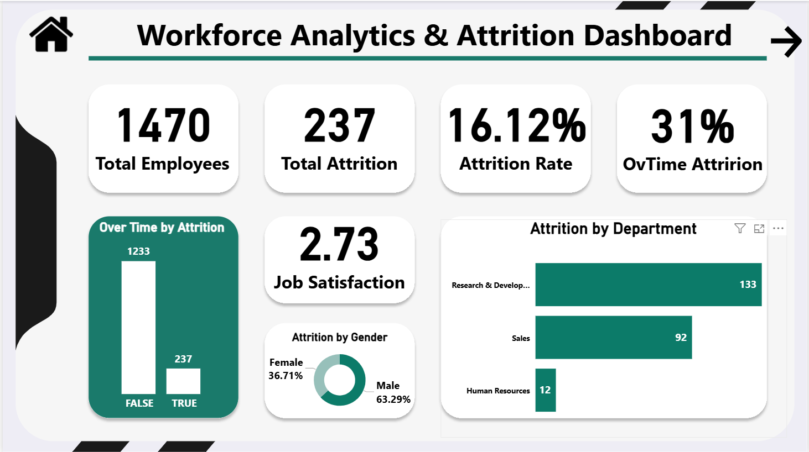
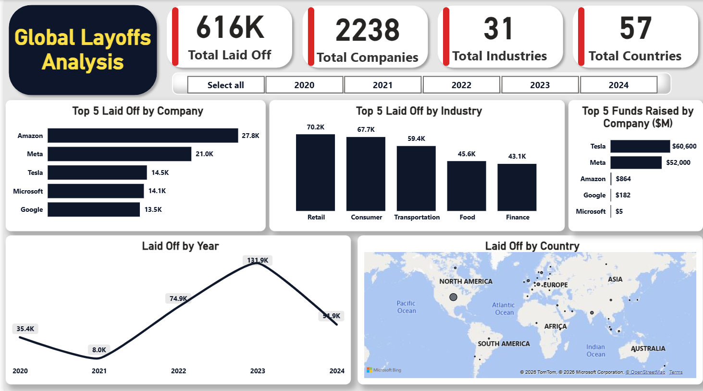
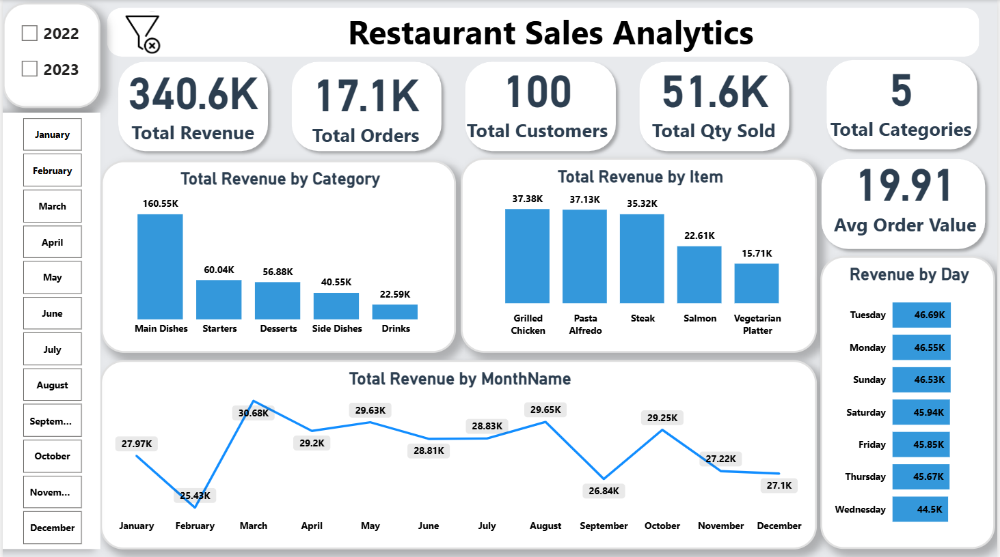

I am a detail-oriented **Data Analyst** focused on turning raw data into clear, actionable insights that drive business decisions. With hands-on experience as a Data Analytics Intern at NGI and a strong foundation in commerce, I specialize in the entire data lifecycle—from rigorous data cleaning and SQL transformations to advanced modeling and interactive Power BI visualizations.

- **Current Role:** Data Analytics Intern at NGI, building enterprise-level retail dashboards.
- **Education:** Third-year student, Faculty of Commerce at Menoufia University.
- **Focus Areas:** Exploratory Data Analysis (EDA), KPI Tracking, Root Cause Analysis, and Business Intelligence.
- **Currently Learning:** Expanding my analytical toolkit with **Python** for advanced data manipulation.

 &nbsp; 

## 🛠️ Tech Stack & Skills

- **Core Competencies:** Data Cleaning & Transformation, Data Modeling, Exploratory Data Analysis (EDA), Profit & Loss Analysis.
- **Technical Execution:** Advanced SQL (CTEs, Window Functions, Subqueries), DAX Measures, Relational Databases, Power BI Dashboard Design.

## 📊 Featured Projects

### HR Attrition Analysis — Workforce & Root Cause Insights
**Tools:** SQL Server (T-SQL) · Power BI · DAX

Comprehensive workforce analytics project investigating employee attrition root causes, department turnover, overtime impact, and job satisfaction. Extracted and cleaned records using SQL, and engineered an interactive Power BI dashboard featuring executive KPIs.
- **Business Impact:** Uncovered actionable insights regarding job role turnover rates and overtime impact to optimize HR retention strategies.
- **Skills:** Advanced SQL Queries, DAX, Minimalist Dashboard Design.

  

🔗 [View Project](https://github.com/Yahia-Farag/End-To-End-HR-Attrition-Analytics)

---

### Global Layoffs Analytics — Corporate Trends & Funding
**Tools:** SQL Server (T-SQL) · Power BI · Power Query · DAX

An end-to-end data auditing, T-SQL cleaning, and Power BI business intelligence project analyzing global corporate layoffs, industry trends, and funding impacts (2020–2024).
- **Business Impact:** Provided a clear macroeconomic overview of industry-specific vulnerabilities, geographic layoff distributions, and post-funding survival rates.
- **Skills:** Data Auditing, Complex T-SQL Transformations, Advanced Power BI Visualizations.

  

🔗 [View Project](https://github.com/Yahia-Farag/End-to-End-Global-Layoffs-Analytics)

---

### Restaurant Sales Analysis — Performance & Revenue Trends
**Tools:** SQL Server (T-SQL) · Power BI · DAX

End-to-end data cleaning and business intelligence project using T-SQL and Power BI to analyze restaurant sales performance, customer metrics, and revenue trends.
- **Business Impact:** Highlighted peak ordering hours, top-performing menu items, and customer dining patterns to drive targeted marketing and operational efficiency.
- **Skills:** ETL Pipeline, Data Cleaning, Relational Modeling, DAX Measures.

  

🔗 [View Project](https://github.com/Yahia-Farag/End-To-End-Restaurant-Sales-Analysis)

## 📈 My Analytical Philosophy

I believe tools are only as good as the questions they answer. My focus goes beyond writing code; it's about mastering the translation process: 

> **Raw Data → Clean Data → Analysis → Insights → Business Decisions**

I prioritize asking the right business questions, selecting the optimal analytical approach, and communicating findings clearly to non-technical stakeholders.

## 🤝 Let's Connect

---

<h3 align="center"><i>Thanks for visiting my profile!</i></h3>

